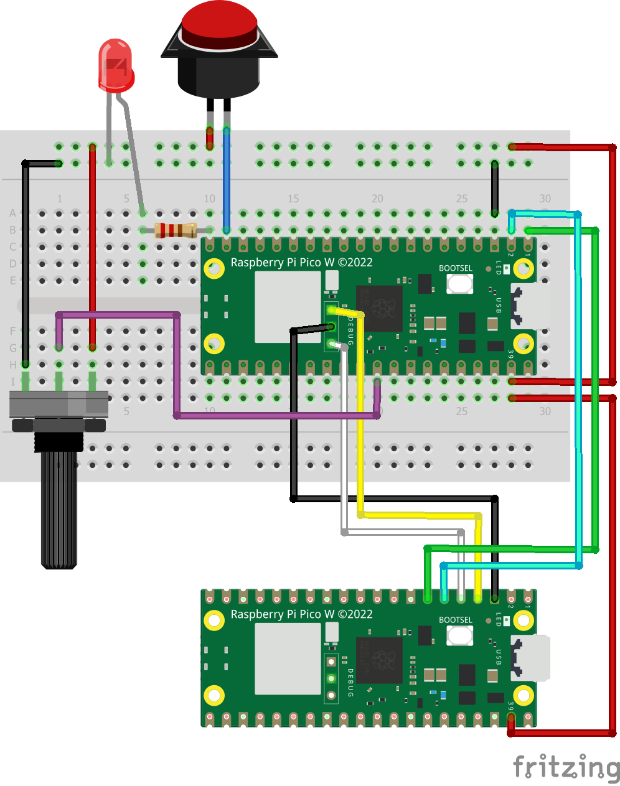
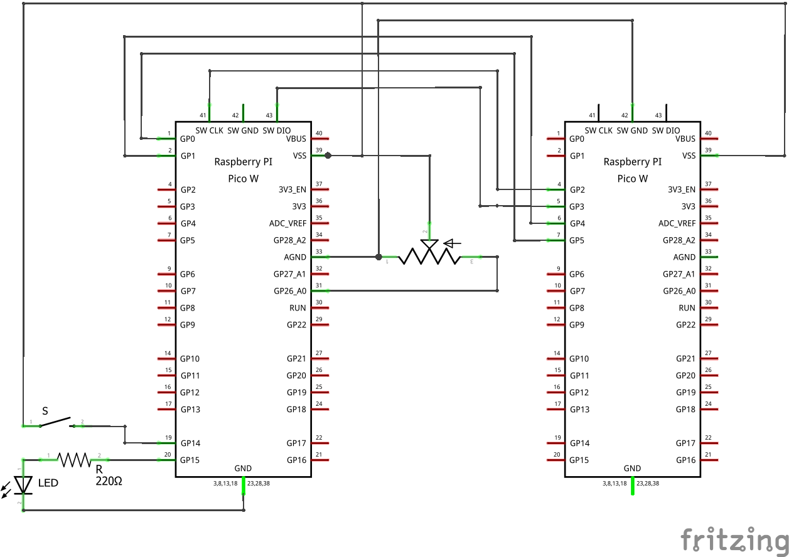
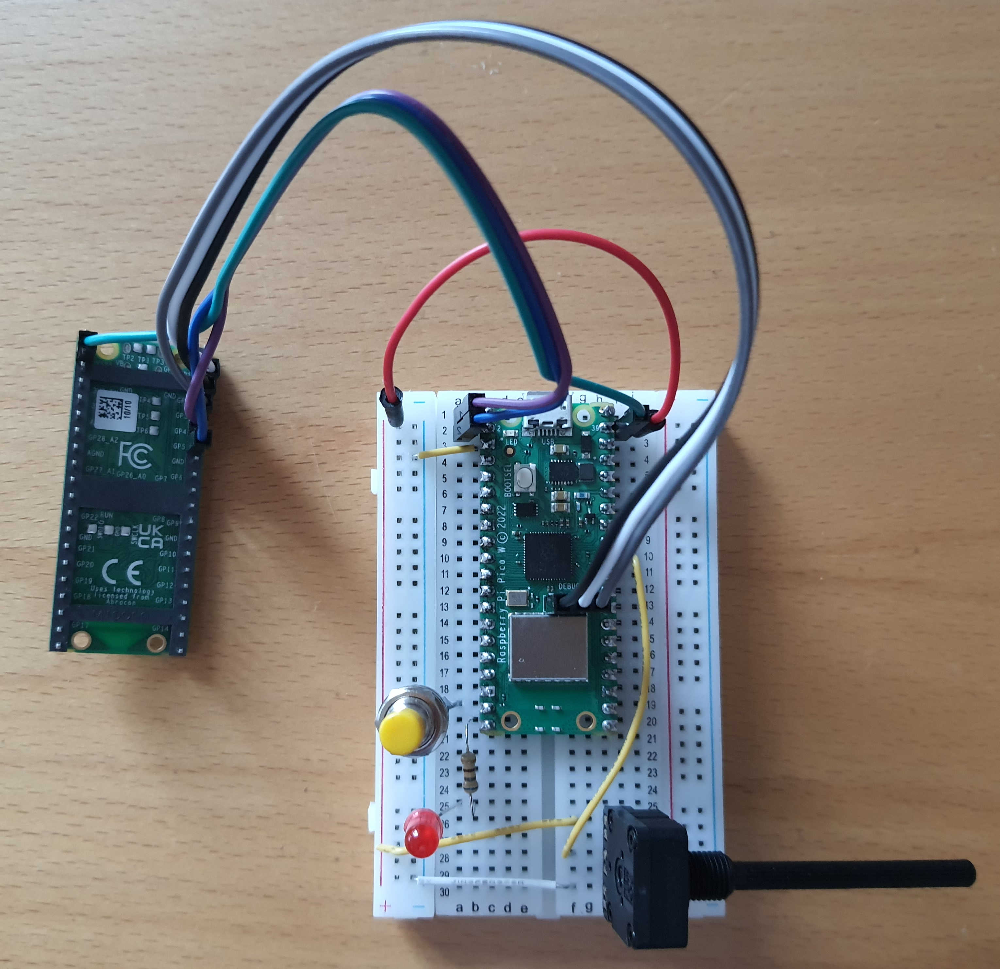

# Use a Pico as a debug probe

This is the lower-cost alternative to the
[official Raspberry Pi Debug Probe](https://www.raspberrypi.com/documentation/microcontrollers/debug-probe.html).
A second Pico-series board runs Raspberry Pi's `debugprobe` firmware and acts
as a CMSIS-DAP USB-to-SWD and UART bridge:

- **Probe board**: the Pico connected to the computer by USB;
- **Target board**: the Pico W or Pico 2 W running the workshop application.

The probe board generation and target board generation do not have to match.

## Flash the probe board

Download the appropriate UF2 from the latest official
[Raspberry Pi debugprobe release](https://github.com/raspberrypi/debugprobe/releases):

| Board used as probe | Firmware |
|---|---|
| Pico / Pico W / Pico H / Pico WH | `debugprobe_on_pico.uf2` |
| Pico 2 / Pico 2 W / Pico 2 with headers | `debugprobe_on_pico2.uf2` |

The filename depends on the board used as the **probe**, not on the target.

1. Disconnect the probe board.
2. Hold **BOOTSEL** while reconnecting it by USB.
3. Copy the matching UF2 to `RPI-RP2` (first-generation Pico) or `RP2350`
   (Pico 2).
4. Wait for the drive to eject and the board to reboot.

This procedure follows Raspberry Pi's official
[Debug using a Pico-series device](https://www.raspberrypi.com/documentation/microcontrollers/pico-series.html#debug-using-a-pico-series-device)
instructions.

## Required SWD wiring

The default `debugprobe` firmware uses GP2 and GP3 for SWD. Connect the signal
names as shown; the target's three debug pads are labelled `SWCLK`, `GND`, and
`SWDIO` on the board.

| Probe board | Physical pin | Target debug connector |
|---|---:|---|
| GP2 / SWCLK | 4 | SWCLK |
| GND | 38 | GND |
| GP3 / SWDIO | 5 | SWDIO |

Do not rely only on “left/middle/right”: the debug connector location and type
differ between W, non-W, and header variants. Follow the labels on the board
and the official
[Pico-series SWD connector diagrams](https://www.raspberrypi.com/documentation/microcontrollers/pico-series.html#debug-connector-swd).

The target SWD connector has **no power pin**. Power the target separately by
USB, or use the optional VSYS connection described below.

## Optional UART bridge

UART is not required for SWD flashing or `defmt`/RTT. Connect it only if the
application uses UART0 for console output:

| Probe board | Physical pin | Target board | Physical pin |
|---|---:|---|---:|
| GP4 / UART1 TX | 6 | GP1 / UART0 RX | 2 |
| GP5 / UART1 RX | 7 | GP0 / UART0 TX | 1 |
| GND | 38 | GND | any GND pin |

TX and RX cross: probe TX connects to target RX, and probe RX connects to
target TX.

## Optional power from the probe board

For this workshop wiring, the probe can also supply the target through VSYS:

| Probe board | Target board |
|---|---|
| VSYS, physical pin 39 | VSYS, physical pin 39 |

If VSYS is connected this way, power both boards from the **probe board's one
USB connection**. Do not also connect the target to another USB port or power
supply. Alternatively, omit the VSYS wire and power the target through its own
USB cable. Always connect GND before connecting SWD or UART signals.

This VSYS wire is specific to the Pico-as-probe workshop setup. It is not part
of the target's three-pin SWD connector and must not be inferred from the
official Debug Probe wiring.

## Workshop wiring images



*Breadboard layout: the debug Pico is the probe; the breadboard Pico is the
target. SWD is required. UART and the VSYS power link are optional.*



*Schematic: GP2/GP3 and GND form the SWD connection. GP4/GP5 form the optional
crossed UART connection. VSYS-to-VSYS is the optional single-source power
link.*



*Physical workshop build. Check signal labels against the tables above; wire
colours alone are not authoritative.*

The complete workshop peripheral wiring is also listed on the
[Breadboard Wiring Test Hardware](./steckbrett-verdrahtung.md) page.

## Test the probe

Connect the probe board to the computer and run:

```sh
probe-rs list
```

The output should contain a CMSIS-DAP probe. Then use the runner matching the
**target** board:

```toml
# Pico W target
[target.thumbv6m-none-eabi]
runner = "probe-rs run --chip RP2040"
```

```toml
# Pico 2 W target
[target.thumbv8m.main-none-eabihf]
runner = "probe-rs run --chip RP235x --protocol swd"
```

From the application project, flash and run:

```sh
cargo run
```

If the probe is listed but the target cannot be contacted, check target power,
common ground, SWCLK/GP2, SWDIO/GP3, and the selected target chip.
